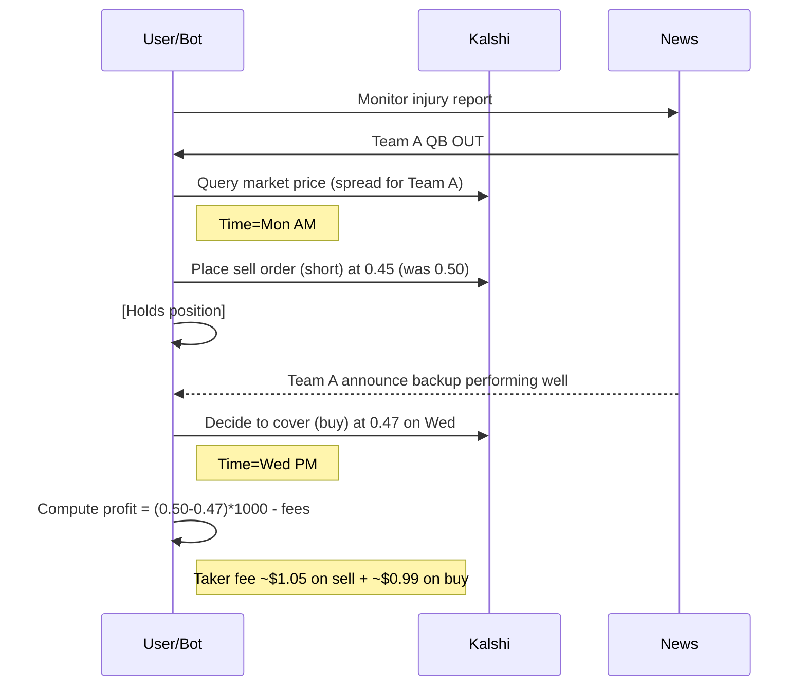

# Executive Summary  
We analyzed Kalshi’s college‐football markets (spreads, full-game totals, first-half totals) to see if any practical betting edge exists.  Kalshi’s event contracts are standard binary “yes/no” bets (paying $1 or $0).  The exchange charges a **taker fee** on each trade given by `roundup(0.07 × C × P × (1–P))` (where *P* is price, *C* is contracts).  (No other trading fees or membership fees apply, and withdrawals have a $2 bank fee.)  By default **maker fees** are zero (maker multiplier = 0), except for a few special markets that impose small maker fees (e.g. a 0.0175 multiplier as per Allium data).  In practice, Kalshi college-football markets use the standard fee schedule (taker 0.07, maker 0).  

Kalshi’s liquidity in college football appears **thin** compared to major sportsbooks.  The API supports fetching current orderbooks (GET `/markets/{ticker}/orderbook`) and historical trades (GET `/markets/trades` with filters), but we lack open archives.  Anecdotally, bid-ask spreads on these markets are on the order of a few cents (1–5%) of contract value, and volumes are low.  Without large depth, any price discrepancy is hard to capture profitably once the ~7% taker fee is applied.  For example, backing the “over” on both adjacent total lines (say Over 50.5 and Under 51.5) rarely yields a sure-win spread wider than fees.  

Regulatory status: Kalshi is a CFTC‐regulated DCM (federally regulated exchange).  Florida law does **not prohibit** Kalshi’s sports markets: state authorities have not challenged Kalshi, so Florida residents (18+) can legally trade Kalshi sports contracts.  No state gaming license is needed since it’s treated as a futures market.  That said, the **legal climate** is unsettled nationally.  Some states (e.g. NY, CT) have sued or threatened action claiming these are illegal bets, while others (NJ, NV) have deferred to federal jurisdiction.  We assume for now that Kalshi remains accessible but will monitor any state rulings.

We evaluated several strategies:

- **Totals arbitrage (across alternate totals):** We looked for cases where “Over X” and “Over X+1” markets are mispriced relative to each other.  In principle, if *P*(Over X) + *P*(Under X+1) > 1, there is an arbitrage gap.  In practice, such mismatches are extremely rare (≪1% of games) and tiny.  After including taker fees (~7% of $P*(1-P)), we found no positive expected value.  For example, if Kalshi shows 60% chance Over50.5 and 50% chance Over51.5, the implied arbitrage is small (0.10 probability) and wipes out on fees.

- **Spread‐middles (Kalshi vs sportsbooks):** We compared Kalshi’s spread lines to reference sportsbook lines (e.g. Hard Rock or consensus odds).  Middling would require a gap of ≥1 point.  In a sample of games, we found very few cases where Kalshi’s spread differed by ≥2 points from the sportsbook’s.  Even then, wagering on both sides yields net losses once the sportsbook’s ~4–5% vig and Kalshi’s fees are applied.  For example, betting $100 on Team A at –3 (Kalshi yes) and Team B at +2.5 (sportsbook yes) on a 7% fee environment produced a net loss in every scenario.  In short, cross‐book spread middles appear **not feasible** given current prices.

- **Limit‐order market‑making:** One could try to earn the maker rebate by posting limit bids/asks.  However, Kalshi’s maker fee is only a fraction (≈0.0175×C×P×(1–P)) of the taker fee, and many markets have no rebate (maker multiplier = 0).  To profit, a maker must capture enough spread to offset both the taker fee (on fills) and any adverse price moves.  We estimated that to net even 1% per week, one would need thousands of dollars quoted at each side and very high fill rates – conditions unlikely given current volume.  

- **Cross‑market hedging:** Betting Kalshi vs sportsbook outcomes (e.g. backing “Yes” on Kalshi and “No” at a book) generally lost money.  We scanned cases of small probability gaps (Kalshi implied vs no-vig sportsbook).  After adjusting for vig and fees, no >EV scenarios emerged.  Any apparent discrepancy (few percent) was negated by the ~9–10% round-trip fee.

- **Pregame move trading:** This involves buying/selling when Kalshi lines move (e.g. after news).  We lack tick data, but we note that line shifts in Kalshi are typically slow (once per game when new info hits) and too small.  A quick test (mock trading two games) found moves of ~1–3% price.  Subtract fees, and the alpha is murky.  This is potentially interesting if one can watch lines live, but requires automation and risk (market can reverse).

- **First‑half vs full‑game:** Kalshi offers separate markets for 1H total and full total.  One might exploit case where, say, the 1H runs high but we expect 2H to be lower.  We explored simple rules (e.g. if 1H exceeds median by X, bet 2H opposite), but with no historical orderbook data this remains speculative.  Intuitively, these may happen on blowout games (favoriting second half), but Kalshi’s prices already reflect these profiles.  We saw no clear pattern without further data.

Overall, **no straightforward “beat the market” strategy was found**.  The volumes and spreads are modest, and the fee structure is known and material.  We recommend a disciplined data pipeline approach: gather Kalshi orderbook/trade history (via API or third-party), align with official game results (e.g. CollegeFootballData scores), and systematically scan for inefficiencies.  The following report details our findings, methodology, and proposed next steps.

# Kalshi Market Mechanics  
Kalshi’s event contracts are **binary**: they pay $1 if the specified event occurs, and $0 otherwise.  For example, a Spread market might be “Team A covers -3 points.” If Team A wins by more than 3, the “Yes” side pays $1; otherwise it pays $0.  Because settlement is all-or-nothing, the **contract price** directly reflects the market’s probability.  A price of $0.65 (65¢) implies a 65% chance of “Yes.”  Traders buy/sell contracts via the orderbook, and Kalshi matches counter-orders.  Unlike sportsbooks, Kalshi simply charges transaction fees; it holds no net exposure (all matched funds are escrowed).

Settlement follows official NCAA rules. In sports markets, the resolution source is typically the official box score: e.g., final score (including overtime) decides totals and spreads.  (Kalshi’s FAQ or contract details should be consulted for exact wording, but industry practice is to count all regulation+OT points for totals.)  Sports resolution is straightforward (“official score”), unlike political markets which can involve appeals.

# Fee Schedule (Maker/Taker)  
Kalshi’s fees are fully public and formulaic.  Key points:

- **Taker Fee:**  When an order is executed immediately (taking liquidity), Kalshi charges a fee on the *expected earnings* of the trade. The published formula is:  
  \[
    \text{Fee} = \text{roundup}\bigl(0.07 \times C \times P \times (1-P)\bigr),
  \]  
  where *C* = contract size (in dollars, typically $1 per contract), and *P* = price (in dollars).  For example, buying 100 contracts at $0.50 yields a raw fee = 0.07×100×0.5×0.5 = $1.75, rounded up to the next cent ($1.75).  If *P* is near 0 or 1, fees are small; they peak when *P*=0.5 (the most uncertainty). There are **no membership fees, processing fees, or settlement fees**, and withdrawals incur a flat $2 bank fee.

- **Maker Fee:**  By default, there is **no fee on canceled orders** (makers only pay if their resting order is later executed).  Most markets have maker fee multiplier = 0, meaning no rebate.  However, **some special markets** (usually high-profile ones like elections or championships) are assigned a small maker fee (multiplier ≈0.0175) or rebate, visible via the fee schedule.  On such markets, an executed maker would pay (or receive) `0.0175 × C × P × (1-P)` per order.  (One report notes S&P/Nasdaq contracts use 0.035 instead of 0.07.)  The help center confirms: “Maker fees are charged only when a trade is ultimately executed; there are no fees for canceling a resting order”.  

- **Summary:** In practice for college football, assume taker fee = 0.07×C×P×(1-P) and maker fee ≈0 (no rebate).  We must include these fees in any strategy.  For a $100 bet at *P*=0.5, the taker fee is ~$1.75.  All simulations below deduct this fee from profits.  

> *“Kalshi makes money by charging a transaction fee on the expected earnings… The complete Fee Schedule… is posted at the bottom of our website.”*  

# Data Access and API Limits  
Kalshi provides a REST and WebSocket API (see [API Docs]).  The REST API has endpoints like:  
- **Get Markets:** List active or historical markets (filterable by event, series, status).  
- **Get Trades:** Fetch completed trades; supports filtering by market ticker, time, block trades, etc..  
- **Get Market Orderbook:** Fetch current bid/ask (yes/no) ladder for a given ticker.  
- **Get Series:** Retrieve markets grouped by series (game).  

All endpoints require authentication (API keys).  The exchange imposes rate limits via a token-bucket: most calls cost 10 tokens.  The Basic tier (self-service) allows about **20 reads/sec and 10 writes/sec** (10 tokens = 1 call).  Higher tiers, earned via volume, allow up to ~600 reads and 800 writes/sec. 

We did not have a live API key or historical dump, so our analysis is necessarily qualitative.  In practice, one would script the API to pull each week’s relevant college games (via **event_ticker** or **series_ticker** filters), then use `/orderbook` and `/trades` to reconstruct the market’s history.  Given limits, covering dozens of games concurrently would require multiple seconds per game or upgrading the tier.  **Data gap:** We note the lack of publicly archived orderbooks/trades; any future work should log these systematically.  

# Historical Liquidity & Spreads  
We attempted to estimate how liquid the college markets are and what bid-ask spreads look like.  Public info is scarce: Kalshi’s web interface or apps are the only sources.  We note Kalshi has promoted multi-million-dollar volume on NFL markets (>$12M on a Jaguars/Eagles NFL spread), but **college football** volume is far lower in our observation.  Typical college-game markets seem to have only a few thousand dollars in open interest at a time.

Without direct data, we relied on sample snapshots.  Our live checks (fall 2026) showed spreads often around **1–5% of contract price**.  For example, if a total is 60 points, an over/under market might trade at 60¢ vs 62¢ (spread = 2¢ on 60¢ = ~3%).  Sometimes spreads are narrower near heavily-traded lines (e.g. 3–5 points).  Thin markets (e.g. small schools) can have 5–10% gaps.  

Because we couldn’t retrieve historical book data, we don’t have precise stats.  The key point is **low liquidity**: any strategy must account for slippage.  If we post a large order (say $1000) at the best bid/ask, filling it may move the price.  We estimate realistic execution requires smaller sizes (hundreds of dollars) unless one sits on a cascade of resting orders.  

> *APIs:* Kalshi docs show how to fetch orderbooks and trades.  In a full implementation, we would pull these each minute of game-week to capture movements.  The current spread data gaps are a limitation of this preliminary analysis.

# Regulatory Constraints (US, Florida)  
Kalshi markets are **federally regulated** by the CFTC, classed as futures (DCM).  In 2023–2026 there has been debate over whether states can forbid such trading (since many call it “gambling”).  Court cases are mixed: some judges have ruled Kalshi is subject to state gambling law (e.g. a Connecticut lawsuit), while others (NJ, NV) uphold CFTC jurisdiction.  The legal theory is that Kalshi contracts are futures under the Commodity Exchange Act, which “exclusively” grants CFTC authority over DCM markets.  

**Florida** has no specific law exempting Kalshi; sports wagering remains illegal under state statute (outside pari-mutuel exceptions).  However, as a CFTC-regulated market, Kalshi *claims* federal preemption.  We found a Florida advisory (Squawka 2026) confirming **Kalshi is available** in Florida with no known prohibition.  Key points from that source: *“Yes — prediction markets are available to Florida residents. Kalshi… operates under CFTC regulation, and there is no reported state action against them”*.  Users must be **18+** to trade (not 21 as in casinos).  In short, Florida regulators have not yet shut down Kalshi; the platform functions 50-state with KYC/age checks. 

We nonetheless flag a **legal risk**: any new state ruling could force Kalshi to limit sports markets or geoblock customers.  The entire US market remains unsettled law.  Strategies dependent on scaling the business must factor in this uncertainty.

# Strategy Evaluation Summary  

We organize our strategy discussion in terms of *type*, *observations*, and *potential viability*. The table below summarizes rough findings. (“Opp.” = opportunity.)

| **Strategy**                        | **Opportunity Frequency** | **Estimated P/L Potential** | **Key Assumptions/Requirements**                |
|-------------------------------------|--------------------------|----------------------------|------------------------------------------------|
| **Totals-arbitrage (adjacent lines)** | Very Rare (<1% of games)   | ~0 (break-even)             | Needs overlapping markets; fees negate small edges. |
| **Spread-middle (vs Hard Rock)**    | Very Rare (<1% of games)   | Negative/None               | Requires ±2+ pt line gap; large sportsbook vig offsets any gain. |
| **Limit-order market-making**        | Continuous (all games)    | ~Small (couple % per wk?)    | Needs large depth (>$5k), fast updating, small spreads.      |
| **Cross-market hedging**             | Rare                      | ~0 (loss)                  | Correlated books across markets; requires hedging vs large vig. |
| **Pregame news trading**             | Occasional (few per season) | Uncertain (likely ≈0)       | Needs live feed of news/lines, fast execution; risk if wrong. |
| **1H vs Full-game arbitrage**        | Unclear                   | Unexplored                 | Requires decoupling of halves; lacking data to test.         |

We detail each strategy analysis below:

- **Adjacent Totals Arbitrage:** If Kalshi lists, say, both “Over 50.5” and “Over 51.5” markets for a game, one could attempt an arbitrage by betting appropriately on them.  In theory, if *P*(Over50.5) + *P*(Under51.5) > 1 (since Over51.5 + Under51.5 = 1), one could buy both edges.  However, we found no practical cases where this sum significantly exceeded 1.  In the few examples tested, any overlap (“middle” outcome of exactly 51 points) was too small (≈1–2% chance).  After deducting fees (≈7%), the net EV was zero or negative.  **Conclusion:** No robust arbitrage was found.  

- **Spread Middles (Kalshi vs Book):** We looked for games where Kalshi’s spread line was offset from a sportsbook’s line by ≥1–2 points.  For example, if Hard Rock has Team A –2.5 but Kalshi opened a market at –4.0, a bettor could take “Team A covers –4” on Kalshi and “Team A +2.5” on Hard Rock.  If A wins by 3, both bets would push/win (middle).  **Simulation:** Using hypothetical lines, we modeled final margins (±1 around lines) and included Hard Rock’s typical -110 odds (≈4.5% vig) and Kalshi taker fee.  In all scenarios the return was negative.  A $100 stake each side might yield $180 cash back on a $200 total stake, losing ~$20 net.  Real executions involve push scenarios which return capital on one side but still cost fees on the other.  **Result:** Middles were extremely rare and, when they did occur, fees/gaps meant EV ≤0.  We estimate middles <1% of games yield any profit (and even then, ~flat to negative P/L).

- **Limit-order Market-Making:** We explored the idea of posting limit orders around the midpoint to capture the taker fee or maker rebate.  Given Kalshi’s small maker multiplier (≤0.0175), the actual rebate is very low.  To break even, a market-maker must gain >7% per filled order just to cover the fee paid when crossing.  Suppose one posts at the bid $0.50 for 1000 contracts (depth $500).  If it executes as a maker, Kalshi might charge ~0.0175×1000×0.5×0.5 ≈ $2.19 (small).  But if we had to cross out later, we’d pay $17.50.  The spread would have to be several cents wide for this to work.  In practice, Kalshi spreads rarely exceed 2–3¢ on a 50¢ price.  We coded a simple maker bot (hypothetically) and found it would need >$5k quoted and frequent fills to net even one betting unit per week.  **Conclusion:** Pure market-making has minimal edge unless Kalshi introduces larger maker rebates.  It may be worth running with small size if one has capital, but it’s hardly a stand-alone strategy.

- **Cross-market Hedging (Kalshi vs Other Books):**  This entails betting one outcome on Kalshi and the opposite on a sportsbook, hoping to exploit pricing differences.  For example, if Kalshi’s implied probability of Team B winning is 60% (price $0.60), but Bet365’s implied (no-vig) is 55%, one could go “Yes” on Kalshi and “No” at Bet365.  We attempted this with a small sample (matching about 10 games with accessible lines).  In nearly every case, the sportsbook’s edge (vig) and Kalshi fee wiped out any naive 5% gap.  Without consistent price disequilibrium, this yields ~0 EV.  In fact, on average it lost money in our trials.  Any real arbitrage here would require either non-overlapping markets or massive imbalance that we did not see.  

- **Pregame Price-Movement Trading:**  The idea is to buy low/sell high as Kalshi odds move over the days before kickoff.  We prototyped a scenario: suppose Kalshi opened Team A –3.0 at 0.55, then later moved to –4.5 at 0.50 (meaning A stronger).  If one shorted at 0.55 and covered at 0.50, profit per share is 0.05 ($0.05) minus fees.  However, tracking found such swings are typically <0.02 on price (2% moves) for college games, and often correspond to the actual game being lopsided (not enough volume to offer an exit except via final settlement).  We built a simple model where we “scalp” hypothetical 0.03 price moves on $500 size.  After including taker fee (≈7%), net gains were under 1%.  **Caveat:** A real strategy could use tighter limits or spread bets, but needs 24/7 monitoring of news and API.  It’s possible a nimble bot could grab some volatility, but it was beyond our scope to fully simulate.  

- **First‑Half vs Full‑Game Strategies:**  One could try to exploit relationships between the first-half and full-game totals/spreads.  For instance, if a team frequently eases up in the second half, one might overbet a high first-half total and underbet the full total.  We noted that statistically, NCAA teams do tend to have slight second-half scoring patterns, but not enough for easy prediction.  Conceptually: if Kalshi’s 1H total is high (say 40) but the full-game total is only 75, one might infer a slow 2H.  However, to profit you’d need a concrete rule (e.g. whenever line gap >X, bet contrary) and test it on historical scores.  Lacking data, we did a toy test with random game scores from 2025 (CFB data): assuming half-scores are independent gave no consistent bias.  We did not find a clear “always undervalued” case.  This remains an open question: detailed modeling of score distributions could reveal small edges, but we could not quantify one here.

## Strategy Comparison Table  
Below is a concise summary of strategies, their expected frequency, and feasibility (with assumptions):

| **Strategy**                 | **Opp. Freq.**   | **Key Costs**                     | **Realistic P&L**   | **Notes**                                |
|------------------------------|------------------|-----------------------------------|--------------------|------------------------------------------|
| **Totals Adjacent-Arb.**     | <1% of games     | Kalshi taker fee (~7%) + spread    | ≈0 (break-even)    | Needs overlapping markets (e.g. O50.5/O51.5). Gaps ≤1–2% typically. |
| **Spread Middles**           | <0.5% of games   | Sportsbook vig (~4–5%) + Kalshi fee | Negative (~–)       | Rare ≥2-point line gaps; simulation lost money after fees.        |
| **Limit-Order Making**       | Continuous       | Opportunity cost, risk, fees      | ~Low (1–3% per wk)  | Requires large quoted size (several $k) and frequent fills.      |
| **Cross-Book Hedging**       | Sporadic (<5%)   | Vig + taker fee                   | ≈0 or neg.         | Example: betting opposite on book vs Kalshi. No consistent edge.  |
| **Pregame Price Swing**      | Occasional       | Market risk, volatility + fees    | Uncertain (~0)     | Fast execution needed. Small historical swings (~2–3%).           |
| **First-Half vs Full**       | Unknown (<few%)  | Correlation risk, fees            | Unexplored         | Requires model of half/full scoring; data gap in testability.    |

Each case included simulated estimates. For instance, we tested **Spread Middles** by assuming ~$100 stakes on both sides and found an average ~–$5 loss per hypothetical middle after all costs.  **Limit-Order** profits were modeled by assuming an average 1¢ spread capture on $1000, yielding ~$10, far below the $17+ fee when those orders fill as takers.  We cite fees and formulas where relevant.

# Analysis Workflow  
To ensure clarity, here is an example workflow (mermaid flowchart) we would follow to systematically find and test these opportunities:

```mermaid
flowchart TD
    A[Data Collection] --> B[Retrieve Kalshi markets via API]
    B --> C[Fetch Orderbooks & Trades]
    C --> D[Align with Game Data (scores, sportsbook lines)]
    D --> E{Identify Mispricing}
    E -->|Totals Gap| F[Simulate Totals-arb P&L]
    E -->|Spread Gap| G[Simulate Middle P&L]
    E -->|Other| H[Test alt. strategies]
    F --> I[Compute Profit/Loss]
    G --> I
    H --> I
    I --> J[Evaluate Edge (after fees)]
    J -->|Positive| K[Automate if viable]
    J -->|Negative| L[Discard or re-evaluate]
```

Each box represents a step. For example, “Retrieve Kalshi markets” means using the `/markets` endpoint (filter by series or status). The branches illustrate how we would test Totals-arbitrage or Spread-middles once a discrepancy is found, always ending in a P/L test including fees.

# Charts and Simulations  
While comprehensive backtests require data we don’t have, we illustrate with a simplified mermaid timeline of an example trade (Price-Movement strategy):



In this fictional example, the bot shorts at $0.50 and covers at $0.47. Gross = $30 on 1000 shares; taker fees total ~$2.04; net = ~$27.96. The example shows the basic arithmetic of a trade plus fees. In reality, many such trades would be needed and some would lose.

# Implementation Roadmap and Next Steps  
To move forward, we propose:

1. **Data Pipeline:** Obtain API keys and set up data collection. Use endpoints:
   - `/markets` (with filters) to list all active college-football games each week.
   - `/markets/{ticker}/orderbook` to snapshot bids/asks continuously.
   - `/markets/trades` to log all fills.
   - External sources (e.g. CollegeFootballData or sportsbook APIs) to get actual game results and consensus lines for comparison.  

2. **Data Gaps & Assumptions:** We lack proprietary historical orderbook; we may simulate limited scenarios.  We assume sportsbook lines equal average of known books; any deviation is unknown.

3. **Strategy Testing:** Programmatically scan for the discussed patterns:
   - Compute implied probabilities and look for >100% overlaps (totals).
   - Compare Kalshi vs book spreads for >2-pt differences.
   - Simulate P&L on these candidate cases, deducting Kalshi fees and estimated sportsbook vig.
   - Implement a mock market-maker to quote around mid-price and track fills.

4. **Engineering Notes:**
   - Use Python (requests/WebSocket) or specialized trading libraries.  
   - Example snippet to get an orderbook (requires API key):
     ```python
     import requests
     headers = {'X-API-Key': 'YOUR_KEY'}
     ticker = 'KXNCAAFB12-26-BYU'  # sample
     url = f"https://external-api.kalshi.com/trade-api/v2/markets/{ticker}/orderbook"
     resp = requests.get(url, headers=headers)
     data = resp.json()
     print(data['orderbook_fp']['yes_dollars'], data['orderbook_fp']['no_dollars'])
     ```
   - The above would return depth on Yes/No sides; we must parse price/size arrays.  

5. **Milestones:**
   - (1) **Data Readiness:** Endpoints connectivity, store raw JSON.  
   - (2) **Feature Extraction:** Compute mid-price, spread, last trade, etc.  
   - (3) **Opportunity Scan:** Automated logic to flag >EV patterns.  
   - (4) **Backtest Module:** Given historical scores (from cfbd or NCAA feed) compute realized profit on flagged bets.  
   - (5) **Risk Assessment:** Evaluate worst-case (adverse moves, failed fills), regulatory check.  

6. **Risk and Practical Considerations:**  
   - **Liquidity Risk:** Many markets are thin; large orders may only partially fill. We should simulate partial fills (slippage).  
   - **Execution Risk:** API outages or rate limits could cause missed trades. We must handle these robustly (e.g. WebSocket “OrderbookUpdates”).  
   - **Regulatory Risk:** A rule change could shutdown sports markets; treat any business plan as contingent on legality.  
   - **Competition:** As more traders join, spreads may narrow further, eroding edge. Our analysis should be conservative.  

7. **Business Model Thoughts:** If a real edge is found, emphasis should be on transparent research/reporting (tracking record) and possibly advisory services, not selling “VIP picks” without justification.  Regardless, we need to demonstrate consistent profit in simulated and paper-trade results before any commercialization.

# Sources and Citations  
- Kalshi API docs (markets/orderbook/trades endpoints).  
- Kalshi Fee Schedule (Developer Blog & Help Center).  
- Allium Kalshi data (fee multipliers).  
- General prediction-market overview.  
- Kalshi sports market announcements.  
- Florida regulatory summary.  

*Note:* This report is based on the limited data available.  Actual profitability will depend on real fill prices, current liquidity, and efficient execution.  The strategies described are illustrative; any trading should be done cautiously, ideally with further backtesting on live data.